  <picture>
    <source media="(prefers-color-scheme: dark)" srcset="assets/hero-dark.svg">
    
  </picture>

  <a href="https://github.com/Weed1"><picture><source media="(prefers-color-scheme: dark)" srcset="assets/btn-party-dark.svg"></picture></a>
  <a href="https://www.linkedin.com/in/yanurfillah"><picture><source media="(prefers-color-scheme: dark)" srcset="assets/btn-raven-dark.svg"></picture></a>
  <a href="https://yanurfillah.com"><picture><source media="(prefers-color-scheme: dark)" srcset="assets/btn-board-dark.svg"></picture></a>

  <picture>
    <source media="(prefers-color-scheme: dark)" srcset="assets/main-quest-dark.svg">
    
  </picture>

  <picture>
    <source media="(prefers-color-scheme: dark)" srcset="assets/quest-board-dark.svg">
    
  </picture>

  Open the scrolls: <a href="https://github.com/Weed1/Catatan">Catatan</a> · <a href="https://yanurfillah.com">yanurfillah.com</a>

  <picture>
    <source media="(prefers-color-scheme: dark)" srcset="assets/trophies-satchel-dark.svg">
    
  </picture>

